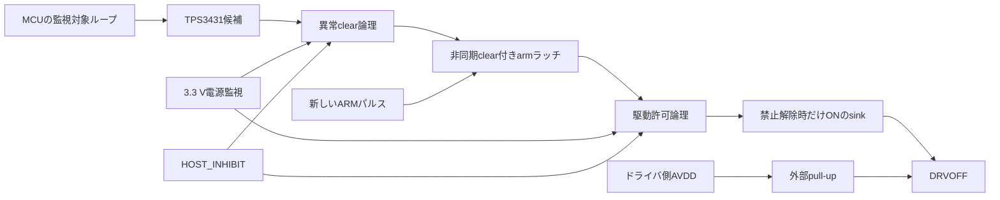

# 駆動禁止回路 — 設計案

更新日: 2026-11-21。T008/T016の部分成果。回路図・実機検証前の論理設計であり、部品の発注用BOMではない。モーター固有の電圧・電流・センサー配列を確定せずに設計できる制御部分を記す。

## 設計判断

通常停止はDRVOFFで三相出力をHi-Zにする。MCUが停止しても外部watchdogで同じ禁止状態へ移行し、watchdogが復帰しても新しいarm操作まで禁止を保持する。これにより通信回復・MCU再起動・watchdog出力の自動解除を再走行のトリガーにしない。

**出典と確度**:

- TI [MCT8316Z SLVSF18B §8.4.1–8.4.2](https://www.ti.com/lit/ds/symlink/mct8316z.pdf): DRVOFF HighはPWMに独立して全MOSFETを禁止し、nSLEEP HighならSPIは使用できる。nSLEEP LowではAVDD/SPIも停止し、sleepでSPI設定はリセットされる。nFAULTはwake/sleepやDRVOFFでもLowとなり得る。メーカー記述として確度High。DRVOFFは機械ブレーキや電池切離しを意味しない。
- TI [TPS3431 SNVSB66A §5/6.6/7](https://www.ti.com/lit/ds/symlink/tps3431.pdf): WDIは立下りでサービスする。WDOはopen-drain、Lowのリセット期間後に解除されるため、WDOだけでは異常後の禁止を保持しない。SET1 High、CWDを10 kΩでVDDへ接続するとtimeoutは170/200/230 ms（min/typ/max）、reset期間も170/200/230 ms。メーカー記述として確度High。
- TI [SN74LVC1G74 SCES794G Table 8-1](https://www.ti.com/lit/ds/symlink/sn74lvc1g74.pdf): active-Lowの非同期clearと立上りclockでQを保持できる。PREとCLR同時Lowを使用しない。メーカー記述として確度High。

## 回路接続案

3.3-V監視電源でwatchdog、armラッチ、論理回路を動作させる。TPS3431とSN74LVC1G74を機能候補とするが、電源監視IC、ゲート、トランジスタの正確な型番・抵抗値・パッケージは未選定。調達・面積・温度・無給電I/Oの評価後にシンボル属性へ確定する。

論理式（active-High信号に正規化）:

`CLEAR_N = WD_OK AND LOGIC_PGOOD AND NOT HOST_INHIBIT`

`RUN_PERMIT = ARM_LATCH_Q AND LOGIC_PGOOD AND NOT HOST_INHIBIT`

`DRVOFF = NOT RUN_PERMIT`（実配線はドライバ側pull-upと、許可時だけsinkする段で実現）

ラッチはD=High、PRE_N=High、CLK=ARM_EDGE、CLR_N=CLEAR_Nとする。初期値に依存せず、電源監視が安定化するまでCLR_NをLowに保つ。HOST_INHIBITは既存D7用途を使う候補で、reset/浮遊時はHighへバイアスする。D7をICへ直結する案から外部禁止回路の入力へ変更する。WD_OKはWDOに適切なpull-upを置いて得る。

監視電源がないときはsink段がOFFとなり、DRVOFFはドライバ側電源でHighへ戻る構造にする。sink段の漏れ、VBE/VGS、電源立上り、driver入力の内部pull-downとの分圧を最悪条件で計算する。DRVOFF pull-up電源にMCU側3.3 Vを使って、MCU無給電時に禁止を失う構成は採用しない。AVDDが立ち上がる以前はIC固有のUVLO/sleep状態との連携を確認する。

## 起動と故障復帰

1. HOST_INHIBIT High、PWM zero、BRAKE Lowで起動。外部ラッチはclear状態。
2. ハードウェアwakeでnSLEEPがHighとなることを確認し、wake完了後にSPI設定を書込みreadbackする。sleep/電源断後は設定を再投入する。
3. センサー・VM・fault状態を確認。出力禁止中のnFAULT Lowを直ちに永久故障としない。
4. watchdogのサービスを開始し、WD_OKと電源正常を確認する。
5. 新しいユーザーarm操作でHOST_INHIBITをLowにする。clear解除後のsetup/recovery条件を満たしてからARM_EDGEを1回発行する。PWM zeroのまま開始し、続く新しいRUN指令で上げる。
6. timeout/電源異常/明示disarmではラッチをclearする。WDO解除や電源正常化だけではQはHighへ戻らない。

nFAULTをそのまま非同期clearへ直結すると、DRVOFFによるnFAULT Lowを原因として解除不能になる可能性がある。現案では直結せず、IC内蔵の適切なlatched保護設定とホスト診断を使う。MCU停止時はwatchdogが禁止する。これが許容できない故障応答時間の場合は、wake/inhibit状態を区別した独立faultラッチを追加して再設計する。

## 時間予算とGPIO

独立watchdogは固定200 ms設定を初期候補とし、監視対象ループで50 msごとにWDI立下りを発行する（設計値）。割込みやPWM/timerだけで自動サービスしない。タイムアウト最大230 msに、出力禁止回路とdriverの遅延を加えたものがMCU停止時の禁止までの上限候補となる。

既存アプリ案の100 ms heartbeat/300 ms leaseは別の時間条件である。ソフトウェアが300 msで禁止できればその時間で止めるが、失効までWDIをサービスした直後にループが停止する場合、最終指令から最大約530 ms（300+230、回路遅延別）を見込む。300 msの機械的停止や最終指令から300 ms以内の独立遮断を保証しない。停止距離の許容値が得られたらleaseとwatchdogを同時に決め直す。

WDIとARM_EDGEに追加GPIOを2本要する。メーカー回路図照合後の候補をD18とD4へ変更した。D15–D17は内蔵flash接続のため使用しない。ARM_EDGEはreset時Low、誤パルス抑制のバイアスを設ける。GPIO不足なら既存予約用途の見直しまたは別制御MCUを比較する。

## 検証条件（すべてNOT TESTED）

| 条件 | 期待動作 | 記録するもの |
|---|---|---|
| USB先行/電池先行/同時起動 | PWM指令にかかわらずarmまでHi-Z | 各電源・CLR_N・Q・DRVOFF・相出力 |
| MCU無給電、driverのみ給電 | 外部sink OFF、DRVOFF High | 禁止電圧、漏れ、逆給電電流 |
| WDIをHigh/Lowで固定 | timeout後にラッチclear | WDI最終edgeから出力禁止までの時間 |
| WDOがLow→Highへ自動復帰 | QはLow保持 | ARM_EDGEなしで再駆動しないこと |
| MCU reset/brownout | ラッチclear、復帰後も再arm待ち | 電源監視閾値、pulse幅、浮遊GPIO |
| 期限切れ/古い指令の再送 | leaseを更新せず禁止 | sequence、受信時刻、禁止時刻 |
| sleep→wake | 禁止したまま再設定 | SPI readback、センサー逆給電、fault推移 |
| fault解除とarmが競合 | clearが優先し意図しない許可なし | setup/hold/recovery条件と波形 |

現時点で最終部品のpin-to-pad照合、ERC/DRC、SPICE、熱/EMC、回路波形や停止距離の実測は行っていない。MCT8316ZR/XSPEED適合や製造可否の判定ではない。

2026-11-21 I/O訂正: メーカーKiCadのnetlist照合でD15–D17は内蔵flashに接続され、予備利用できないことが分かった。D13/D14もIMUバスである。追加端子案はD4=ARM_EDGE、D18=WDIとし、nFAULTをD5へ移す。nSLEEPは電源監視に基づく安全なハードウェアwakeへ変更を検討する。詳細とメーカー/coreのSDA/SCL不一致は[controller-compatibility.md](controller-compatibility.md)を参照。未割付2本を解決した配線案であるが、回路定数・ファームウェア・現物revisionの検証は未完了。
