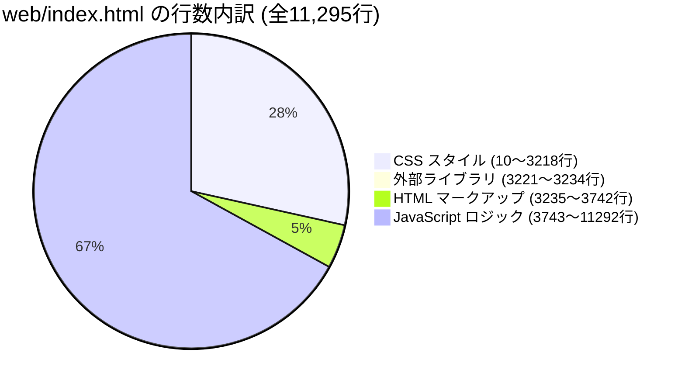
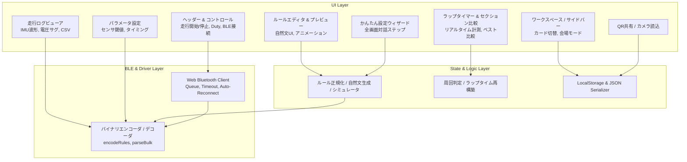

# `web/index.html` アーキテクチャ仕様書 & リファクタリング計画書

本書は、`web/index.html`（AI制御 ミニ四駆 レースコンソール v4.21-r40）のシステム仕様、BLE通信プロトコル、内部データモデル、UIモジュール構成、および将来的なリファクタリングと改修に向けた実装指針を体系的にまとめたドキュメントです。
CodexをはじめとするAIエージェントおよび開発者が、本アプリの仕様を正確に把握し、安全に改修・リファクタリングを実施できることを目的とします。

---

## 1. アプリケーション概要

- **名称**: AI制御 M四駆 Rules Realtime v4.21-r40 race console
- **対象デバイス**: ESP32ベースの自作ミニ四駆モータードライバー基板（BLE搭載、IMUセンサ・電圧センシング・MOSFET PWM駆動）
- **動作環境**: Web Bluetooth API 対応ブラウザ（Google Chrome, Microsoft Edge, Android Chrome）
- **ファイル形態**: HTML / CSS / JavaScript / 外部ライブラリが1つのファイル（`web/index.html`、約828KB、11,295行）に集約されたスタンドアロンSPA

### 主要機能
1. **マシン走行制御**: BLE経由での走行開始（RUN）・停止（STOP）・通常出力（Duty %）の設定
2. **リアルタイムモニタリング**: 走行ステータス（IDLE/READY/RUNNING/STOPPED/ERROR）、推定速度、認識セグメント、テレメトリ（電圧VBAT・サグ・基板温度）
3. **ルールベース走行制御エディタ**:
   - IF条件: セグメント遷移パターン（直線・コーナー・ウェーブ・ピーク・待機など最大8ステップ）
   - トリガー条件: 毎回 / 奇数回 / 偶数回 / N回目のみ / N回周期 + 成立後確認時間（Gate）
   - THENアクション: ブレーキ / 出力調整 / 停止 / 待機 / 無効化（最大5アクション連続実行）
   - 動作シミュレーション: コース上の挙動アニメーションプレビュー
4. **周回認識 & ラップタイマー**: コース周回パターンの認識、リアルタイムラップタイム計測、ベストラップ、セクション別ログ比較
5. **走行ログ解析**: 停止後に車体Flashから高精度バルクログを取得、IMU角速度・セグメント遷移・電圧サグ・ルール発火タイミングをタイムライン表示・CSVエクスポート
6. **かんたん設定ウィザード**: 対話的質問（全画面モーダル）による初心者向けステップバイステップルール作成
7. **設定の共有・永続化**: JSON入出力、QRコード生成・カメラ読込（jsQR + qrious + lz-string）、ブラウザlocalStorage保存、車体Flashへの永続書き込み

---

## 2. ファイル構成とコード分布

全11,295行の構成内訳は以下の通りです。



| セクション | 行範囲 | サイズ/行数 | 概要 |
|---|---|---|---|
| `<head>` & `<style>` | 1〜3218行 | 約3,200行 | サイバーパンク/レーシング調のダークテーマ、グリッド背景、オーロラ/スキャンラインアニメーション、各UIコンポーネント（カード、ボタン、グリッド、モーダル、レスポンシブ）のスタイル定義 |
| 外部ライブラリ | 3221〜3234行 | 14行 (minify) | `qrious` (v4.0.2: QR生成), `jsQR` (v1.4.0: QR認識), `lz-string` (v1.5.0: 設定圧縮) |
| HTML DOM (`<body>`) | 3235〜3742行 | 約508行 | 固定ヘッダー、ワークスペース（サイドバー + カード表示領域）、各種モーダル（ウィザード、QR、ヘルプ、保存確認） |
| メインスクリプト (`<script>`) | 3743〜11292行 | 約7,550行 | 即時関数 `(() => { ... })()` 内に全状態変数、BLEハンドラ、データエンコード/デコード、UIレンダリング関数を定義 |

---

## 3. BLE通信 & プロトコル仕様

Web Bluetooth API（GATT Client）を使用し、ミニ四駆本体（GATT Server）と非同期通信を行います。

### 3.1 サービス & キャラクタリスティック UUID

サービス UUID: `12345678-1234-5678-1234-56789abcdef0`

| キャラクタリスティック | UUID (`...abcdef*`) | プロパティ | 用途 / フォーマット |
|---|---|---|---|
| `command` | `...abcdef4` | Write | コマンド送信（開始、停止、Flash保存、ログ要求など） |
| `status` | `...abcdef5` | Read, Notify | 車体状態（1バイト: 0=IDLE, 1=READY, 2=RUNNING, 3=STOPPED, 4=ERROR） |
| `seg` | `...abcdef6` | Read, Notify | リアルタイム認識セグメント通知（セグメントID、角速度など） |
| `speed` | `...abcdefa` | Read, Notify | 推定速度・走行時間通知 |
| `params` | `...abcdf00` | Read, Write | センシング・判定パラメータ（各閾値、判定時間など固定長バイナリ） |
| `rules` | `...abcdefd` | Read, Write | 走行制御ルール（47バイト/ルール × 最大8件 ＋ ラップトレーラー16バイト） |
| `bulk` | `...abcdefc` | Read, Notify | 停止後バルクログデータ（パケット分割シーケンス送受信） |
| `telemetry` | `...abcdf01` | Read, Notify | 低速周期テレメトリ（VBAT電圧、中間電圧、基板温度など） |
| `adaptiveBrake`| `...abcdf02` | Read, Write | 電圧・サグ適応ブレーキ補正パラメータ |
| `firmwareInfo` | `...abcdf03` | Read | ファームウェアバージョン文字列（ASCII） |
| `deviceName`   | `...abcdf04` | Read, Write | BLEアドバタイズ名（最大20文字） |

### 3.2 コマンド一覧 (`CMD_*`)
`command` キャラクタリスティックへバイト配列を書き込みます。

- `[1, duty]`: 走行開始（RUN）。指定Duty比で走行を開始
- `[2]`: 走行停止（STOP）。モーター駆動をカットして停止
- `[3]`: 車体Flashメモリへの設定保存（現在適用中のパラメータ・ルールを保存）
- `[4]` (`CMD_LOG_REQUEST`): 停止後ログの転送要求を開始
- `[7, seqLow, seqHigh]` (`CMD_LOG_GET`): 指定シーケンス番号のバルクログ行を取得
- `[8]` (`CMD_LOG_ABORT`): ログ転送の中断
- `[9]`: キャリブレーション（ジャイロ・オフセット補正等）

### 3.3 ルールバイナリ構造 (`encodeRules`)
`rules` キャラクタリスティック（最大約394バイト）：

```
[Header: 2 bytes]
  0: format_version (常に 5)
  1: rule_count (0〜8)

[Rule Entries: 47 bytes × rule_count] (base = 2 + r * 47)
  base+00: pattern_length (0〜8)
  base+01..08: pattern[0..7] (セグメントID 8バイト)
  base+09: actions_length (0〜5)
  base+10..14: action_type[0..4] (ACTION enum: 0=NONE, 1=BRAKE, 2=SPEED, 4=STOP, 5=WAIT, 6=LOCK, 7=CANCEL)
  base+15..24: action_duration[0..4] (Uint16LE × 5: 各実行時間 ms)
  base+25..29: action_strength[0..4] (Uint8 × 5: 出力/ブレーキ強度 0〜255)
  base+30: loop_mode (0または1)
  base+31: trigger_mode (TRIG enum: 0=EVERY, 1=ODD, 2=EVEN, 3=EVERY_N, 4=ONLY_N)
  base+32: trigger_n (1〜255)
  base+33: priority (1〜255, デフォルト 100)
  base+34..35: peak_after_ms (Uint16LE, 0xFFFF=未設定)
  base+36..37: straight_hold_ms (Uint16LE, 0xFFFF=未設定)
  base+38..39: curve_long_ms (Uint16LE, 0xFFFF=未設定)
  base+40..41: wildcard_ms (Uint16LE: ★待機時間 0〜2000ms, デフォルト 1000ms)
  base+42..43: confirm_ms (Uint16LE: 発火前確認時間 0〜500ms)
  base+44..45: confirm_cancel_mask (Uint16LE: キャンセルマスク)
  base+46: trigger_phase (1〜255, サイクル内の対象位相)

[Optional Lap Trailer: 16 bytes] (lapBoundaryPattern が存在する場合)
  +00..03: 'L', 'A', 'P', '1' (マジックバイト)
  +04:     pattern_length (1〜8)
  +05..12: pattern[0..7] (ラップ境界パターン 8バイト)
  +13:     passes_per_lap (周回あたりの通過回数)
  +14:     occurrence_n (N周に1回判定)
  +15:     occurrence_phase (位相)
```

### 3.4 バルクログのパケット構造 (`parseBulkRowsFromPacket`)
停止後に `command` で要求し、`bulk` キャラクタリスティック経由で受信する1レコードの構造（エントリー長 20〜28バイト）：
- `t` (Uint16LE): 走行開始からのミリ秒
- `seg` (Uint8): 認識セグメントID
- `rule` (Uint8): 発火したルール番号 (0xFF = なし)
- `act` (Uint8): 実行アクション
- `gz` (Int16LE / 10): ジャイロ角速度 (dps)
- `peak` (Int16LE / 10): ピーク角速度
- `dur` (Uint16LE): セグメント継続時間 (ms)
- `vbatMv` (Int16LE): バッテリー電圧 (mV)
- `sagMv` (Int16LE): 電圧サグ (mV)
- `temp10` (Int16LE): 基板温度 (°C × 10)

---

## 4. コアデータモデル & 列挙型 (Enum)

### 4.1 セグメント定義 (`SEG`, `SEG_META`)
車載IMU（ジャイロ・加速度）により車体がリアルタイム認識する走行状態：

| ID | 定数名 | 日本語表記 | 分類 | 内容 |
|---|---|---|---|---|
| 1 | `STRAIGHT` | 直線 | 直線類 | 直線を走行中 |
| 2 | `RIGHT` | 右C | 右C類 | 右コーナー旋回開始 |
| 4 | `LEFT` | 左C | 左C類 | 左コーナー旋回開始 |
| 6 | `WAVE` | ウェーブ | 直線類 | 左右の小刻みな連続切り返し |
| 7 | `LEFT_PEAK` | 左ピーク後 | 左C類 | 左コーナーの角速度ピークを通過した瞬間 |
| 8 | `RIGHT_PEAK` | 右ピーク後 | 右C類 | 右コーナーの角速度ピークを通過した瞬間 |
| 9 | `STRAIGHT_HOLD` | 直線継続 | 直線類 | 一定時間以上直線が継続 |
| 10 | `LEFT_HOLD` | 左C継続 | 左C類 | 一定時間以上左旋回が継続（大回り・180度等） |
| 11 | `RIGHT_HOLD` | 右C継続 | 右C類 | 一定時間以上右旋回が継続 |
| 14 | `WILDCARD` | 時間待機 (★) | 特殊 | 指定ミリ秒待機するワイルドカード |
| 15 | `LAP` | 本体ラップ | システム | 車体ファームウェアが周回境界を認識 |
| 16 | `RUN_START` | 走行開始 | システム | 走行開始イベント |
| 17 | `RUN_STOP` | 走行停止 | システム | 停止イベント |

### 4.2 アクション定義 (`ACTION`, `ACTION_LABEL`)
ルール成立時にモーターへ指示する制御コマンド：

- `0: NONE`: なし
- `1: BRAKE`: 電気ブレーキ（逆回生/ショートブレーキ）。`strength`（強度 0〜255）と `durationMs` を指定
- `2: SPEED`: モーター出力（Duty%）の一時変更。`strength`（0〜255）と `durationMs` を指定
- `4: STOP`: 走行の強制停止（そのままIDLEへ移行）
- `5: WAIT`: 現状出力を維持しながら指定時間待機
- `6: LOCK`: アクション無効化
- `7: CANCEL`: 他の予約中アクションをキャンセル

### 4.3 トリガー条件 (`TRIG`, `TRIG_NAME`)
- `0: EVERY`: 毎回（パターン成立ごとに発火）
- `1: ODD`: 奇数回目のみ発火
- `2: EVEN`: 偶数回目のみ発火
- `3: EVERY_N`: N回周期（例: 3回に1回）
- `4: ONLY_N`: N回目のみ（例: 1周目のみ発火させたい場合）

---

## 5. UIモジュール & 内部アーキテクチャ

`index.html` 内部のJavaScriptロジックは、大きく7つのモジュール領域に分かれています。



1. **BLE 通信マネージャ (Lines 3786〜4110, 8050〜8380)**:
   - 排他制御 GATT キュー (`queueGattWrite`), リトライ, 切断検知, タイムアウトハンドリング
   - 信頼性ログ転送 (`reliableDump`: パケット欠落時のシーケンス番号再要求)
2. **ルール管理 & シミュレーション (Lines 4110〜6300)**:
   - ルールの正規化 (`ensureRuleDefaults`), 自然文サマリ (`buildRuleSentence`)
   - コースSVG描画 + アクションタイムライン + ミニ四駆の走行アニメーションエンジン
3. **ラップタイマー & 周回認識 (Lines 6300〜7900, 8380〜9110)**:
   - `performance.now()` ベースの高精度タイマー、車体リアルタイム通知連携
   - 走行ログからの周回自動推定・セグメントアラインメント比較
4. **ワークスペース & レイアウト管理 (Lines 9281〜9415)**:
   - カードの並び順・表示/非表示の永続化、リサイズバー、URLハッシュナビゲーション（`#run`, `#params`）
   - 会場モード（高コントラスト屋外視認性モード）
5. **かんたん設定ウィザード (`GuideWizard`, Lines 9416〜10582)**:
   - 全画面対話型UI（「どこで」「何をしたいか」「どのくらい」を1画面1問で決定）
   - 自然言語サマリ生成とルール帳（Rule Book）管理
6. **インポート / エクスポート / QR (Lines 10583〜10984)**:
   - JSON ファイル入出力
   - `lz-string` による設定圧縮、`qrious` によるQRコード描画、`jsQR` + WebRTC カメラストリームによるリアルタイムQR読込
7. **パラメータ設定 & 永続化 (Lines 7900〜8050, 9110〜9280)**:
   - センサ閾値（カーブ判定、ウェーブ判定、ピーク感度等）のバイナリ送受信
   - デバイス名変更、ファームウェアバージョン互換性チェック

---

## 6. リファクタリング & 改修ロードマップ

現状の最大の課題は、**11,295行が1ファイルに混在**しており、グローバル変数（状態）とDOM操作（UI）が直接密結合している点です。
これを段階的にモダンな構成へ移行するためのロードマップを定義します。

### フェーズ 1: ロジックの切り出しと単体テスト（現行構成のまま着手可能）
1. **プロトコル / バイナリ処理の分離**:
   - `encodeRules()`, `parseBulkRowsFromPacket()`, パラメータシリアライザを純粋関数として抽出。
   - Node.js / Vitest でバイナリの往復テスト（Round-trip test）を構築。
2. **ルール自然文生成・シミュレータの分離**:
   - ルールデータ構造のバリデーション、自然文生成ロジックの抽出。

### フェーズ 2: ディレクトリ分割とビルドツールの導入 (Vite + TypeScript)
推奨するディレクトリ構成：

```
web/
├── index.html                 # エントリーポイント
├── package.json
├── vite.config.ts
├── src/
│   ├── main.ts                # アプリ初期化
│   ├── styles/                # CSS 分割
│   │   ├── base.css           # リセット、ルート変数、アニメーション
│   │   ├── layout.css         # ヘッダー、ワークスペース、サイドバー
│   │   └── components/        # カード、ボタン、モーダル
│   ├── ble/                   # BLE 通信モジュール
│   │   ├── client.ts          # Web Bluetooth 接続・GATT キュー
│   │   ├── constants.ts       # UUID, コマンドID
│   │   └── protocol.ts        # バイナリ encode/decode
│   ├── models/                # 型定義・データモデル
│   │   ├── segment.ts         # SEG 定数・メタデータ
│   │   ├── action.ts          # ACTION 定数
│   │   └── rule.ts            # Rule インターフェース・バリデータ
│   ├── services/              # ビジネスロジック
│   │   ├── lap-timer.ts       # ラップ計測・周回認識
│   │   ├── telemetry.ts       # テレメトリバッファ・統計
│   │   └── storage.ts         # LocalStorage, JSON, QR (lz-string)
│   ├── components/            # UI コンポーネント (Vanilla TS または 軽量フレームワーク)
│   │   ├── header/
│   │   ├── workspace/
│   │   ├── rules-editor/
│   │   ├── rule-preview/
│   │   ├── lap-view/
│   │   ├── telemetry-graph/
│   │   └── wizard/
│   └── lib/                   # 外部ライブラリ (npm 管理へ移行)
│       ├── qrious/
│       ├── jsqr/
│       └── lz-string/
```

### フェーズ 3: 状態管理（State Management）のクリーン化
- グローバル変数（`rules`, `logRows`, `device`, `ch` など）を `EventEmitter` または軽量な Store（例: `zustand` や `nanostores`、もしくはシンプルな `EventTarget` 拡張クラス）に集約。
- UI側は Store の購読（Subscribe）によりリアクティブに再描画するよう改修。

### フェーズ 4: テストハーネス & モック環境の整備
- 実機がなくてもWebアプリを開発・検証できるように、**Web Bluetooth Mock（仮想ミニ四駆エミュレータ）**を実装。
- 仮想のIMU波形やセグメント通知を流すことで、ブラウザ上でリアルタイム表示やログ取得の動作確認が可能になる。

---

## 7. 開発・改修時のチェックリスト

- [ ] **GATT 排他制御**: Web Bluetooth は同時に1つのGATT操作しか行えないため、必ず `queueGattWrite` 経由で送信すること。
- [ ] **バイナリパディング / エンディアン**: すべてのリトルエンディアン（Uint16LE, Int16LE）と構造体パディング（47バイト固定長など）をファームウェア仕様と厳格に合わせること。
- [ ] **既存設定との互換性**: LocalStorageキー（`mini4ai_rules_v4_16` 等）やQRコードの互換フォーマットを破壊しないこと。
- [ ] **XSSサニタイズ**: 外部由来データ（QR/JSONインポート時の `_guideMeta` やルール名）を描画する際は必ず `esc()` でエスケープすること。
